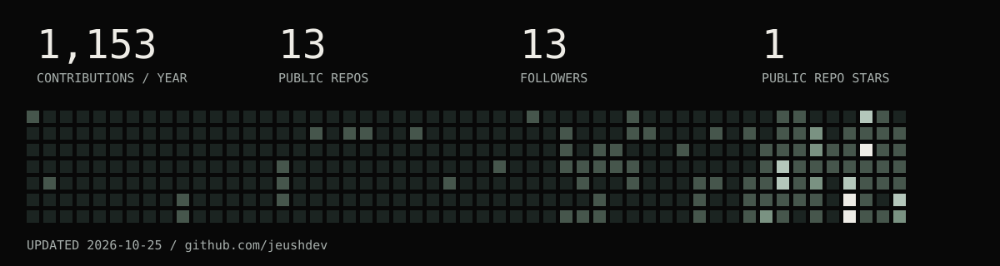

<h1>
<picture>
  <source media="(max-width: 600px)" srcset="assets/profile/hero-mobile.svg">
  
</picture>
</h1>

CS @ **BatStateU** · Co-Founder & Co-Tech Lead @ **Camyx** · Philippines

  
  
  
  
  
  
  
  
  

### `01` Projects

| # | Project | Brief |
| :-- | :-- | :-- |
| `01` | **[TrackStock](https://trackstock.jeushdev.me/)** | Inventory & branch operations. Solo build. |
| `02` | **Sulyap Dental Studio** | Camyx clinic demo. Backend & automation; integration in progress. |
| `03` | **[Campaign Brief Studio](https://github.com/jeushdev/campaign-brief-studio)** | AI campaign drafts + human review. Local demo. |
| `04` | **[ReVoice](https://github.com/jeushdev/revoice)** | Team hackathon project. Android contribution; AI integration unfinished. |

### `02` Activity

<picture>
  <source media="(max-width: 600px)" srcset="assets/profile/activity-mobile.svg">
  
</picture>

GitHub-visible activity · [data](assets/profile/stats.json)

---

[Email](mailto:jeushsamuelb@gmail.com) · [LinkedIn](https://www.linkedin.com/in/jeush-samuel-bantayaon/) · **jeushdev.me** `coming soon`
